# Diagramas — NutriEduc

Diagramas do sistema derivados do **código atual**, não da intenção das specs.

**Fontes:** `backend/Program.cs` (DI), `backend/Infrastructure/DataBase/ConnectionContext.cs`
(DbSets, FKs, índices), enums e métodos de transição em `backend/Domain/Entities/`,
`backend/API/Services/`, `frontend/src/routes/routes.tsx`.
Levantado em **2026-11-17**.

**Como renderizar:** os blocos são [Mermaid](https://mermaid.js.org/) — renderizam direto no
GitHub/GitLab e no preview do VS Code. Não há imagem versionada; o texto é a fonte.

---

## 1. Camadas e dependências

**Fato que importa:** o backend é **um único projeto** (`backend/backend.csproj`,
`net10.0`), não quatro assemblies. As camadas são pastas e namespaces, e a fronteira é
mantida por convenção + teste — `backend/Domain` tem **zero** `using` de
`Microsoft.EntityFrameworkCore`, e quem mapeia é `Infrastructure`.

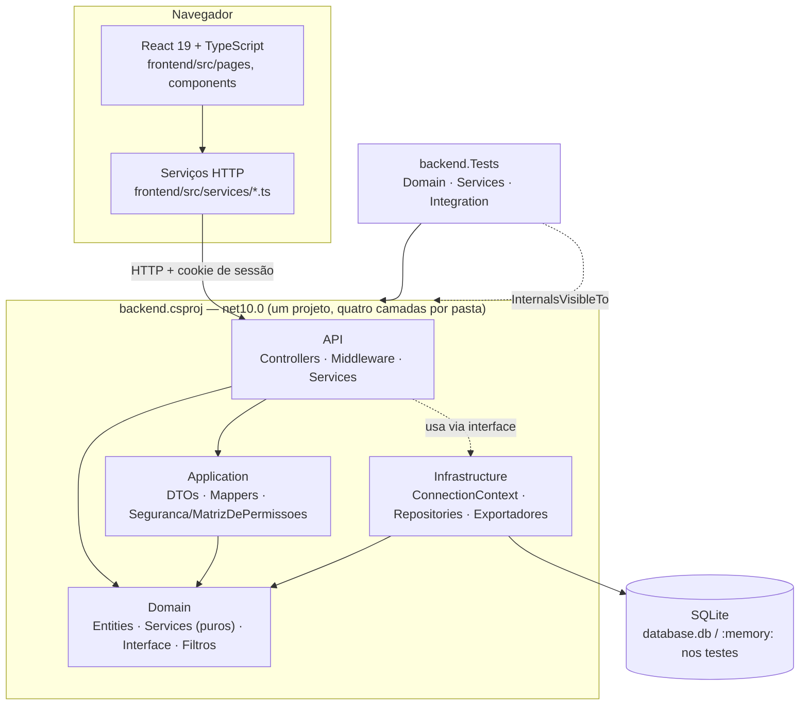

**Regras que o diagrama representa**

| Regra | Onde está garantida |
| --- | --- |
| `Domain` não conhece EF nem HTTP | ausência de `using Microsoft.EntityFrameworkCore` em `backend/Domain` |
| `Controller` não calcula regra de papel | `EscopoUsuario` + `MatrizDePermissoes` (Spec 028) |
| Repositório não abre conexão própria | `IUnidadeDeTrabalho` com `ConnectionContext` Scoped (L4) |
| Erro de domínio vira HTTP em um só lugar | middleware em `API/Middleware` (Spec 007) |

---

## 2. Mapa de módulos e dependências

Regra declarada em `management/arch.md` §11: nenhum módulo reimplementa regra de outro.

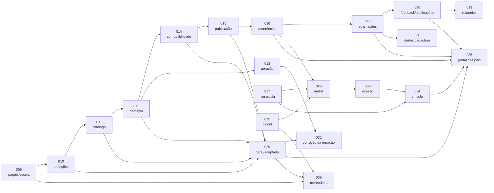

---

## 3. Modelo de dados (ER por agregado)

Extraído de `ConnectionContext.cs`. Cardápio e catálogo aparecem em diagrama próprio
porque concentram a maior parte das relações.

### 3.1 Identidade, escola e aluno

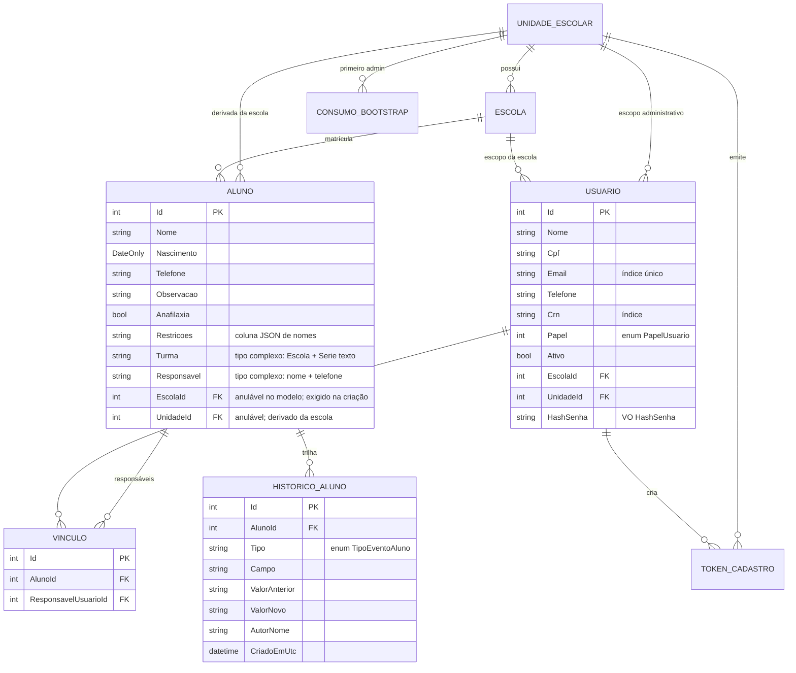

### 3.2 Catálogo e cardápio

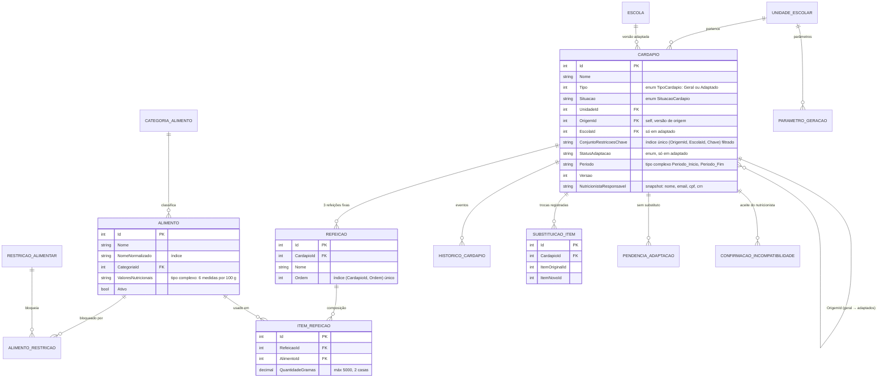

### 3.3 Solicitações, ocorrências, feedback, notificações

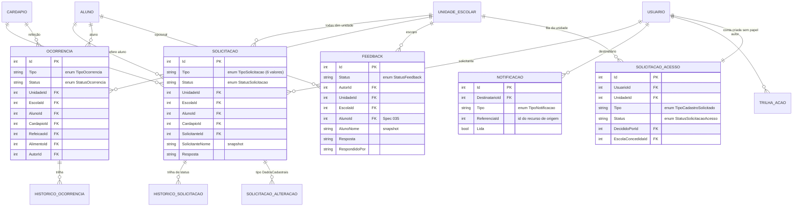

**Nuances que o ER não mostra:**

- `Turma`, `Responsavel` (do aluno), `Periodo` e `ValoresNutricionais` são **tipos
  complexos** (`Owned`/complex type), não tabelas — aparecem como colunas prefixadas.
- `Aluno.Restricoes` é **coluna JSON** com nomes de restrição; o catálogo
  (`RestricaoAlimentar`) é normalizado. É a dívida registrada em `arch.md` §9 e o candidato
  C8 de `classes-candidatos.md`.
- Enums são persistidos como **inteiro**; acrescentar valor ao fim é alteração aditiva sem
  migração de dados (o próprio `SituacaoCardapio` documenta isso).
- `TrilhaAcao.AlvoId` é polimórfico (guarda id de recursos diferentes).

---

## 4. Fluxo de criação, adaptação e publicação de cardápio

```mermaid
sequenceDiagram
    autonumber
    actor N as Nutricionista
    participant API as CardapioController
    participant CS as CardapioService
    participant CR as ContextoDeRestricoesService
    participant AD as AdaptarCardapioService
    participant DOM as AdaptacaoDeCardapio (puro)
    participant PB as PublicacaoCardapioService
    participant DB as ConnectionContext
    actor M as Merendeira
    actor R as Responsável

    N->>API: POST /api/cardapios (nome, período, refeições)
    API->>CS: Criar(dto, escopo)
    CS->>AD: resolver grupos (escola, conjunto de restrições)
    AD->>CR: alunos e restrições por escola
    loop cada (escola, conjunto)
        AD->>DOM: Adaptar(geral, conjunto, catálogo)
        DOM-->>AD: substituições, pendências, StatusAdaptacao
        Note over DOM: Atualizado se achou substituto seguro<br/>PendenteDeRevisao se não achou
    end
    AD->>DB: grava geral + adaptados na MESMA transação
    CS-->>API: detalhe com tipo, origem, escola, conjunto, status
    API-->>N: 201 Created

    Note over N,DOM: incompatibilidade bloqueante exige<br/>confirmarIncompatibilidades = true

    N->>API: POST /api/cardapios/{id}/publicar
    API->>PB: Publicar(id, escopo)
    PB->>PB: CRN válido? (Spec 031)
    PB->>PB: incompatibilidade (422), sobreposição de período (409)
    PB->>PB: adaptado PendenteDeRevisao/Desatualizado? (409)
    PB->>DB: Situacao = Publicado, anterior = Substituido
    PB->>DB: HistoricoCardapio + Notificacao
    Note over PB: geral notifica merendeiras da unidade;<br/>adaptado notifica as da escola da versão
    API-->>N: 200 OK

    M->>API: GET /api/painel/merendeira
    API-->>M: cardápio geral do dia + alunosComRestricao por item

    R->>API: GET /api/aluno/{id}/cardapio?data=
    API->>API: CardapioServidoService escolhe por (escola, conjunto)
    API-->>R: cardapioGeral + cardapioAdaptado (ou alerta de indisponível)
```

**Leitura do diagrama**

| Etapa | Regra que pode barrar | Código |
| --- | --- | --- |
| Criar | nutricionista sem CRN → 400 | `ValidacaoDeNutricionista`, `PoliticaDeCrn` |
| Adaptar | limite de 50 versões por origem → 422 | `LimiteDeAdaptacoesException` |
| Adaptar | sem substituto → versão `PendenteDeRevisao` (não publicável) | `AdaptacaoDeCardapio` |
| Publicar | item bloqueante sem confirmação → 422 | `AnaliseCompatibilidade` |
| Publicar | período sobreposto → 409 | `PeriodoVigencia`, `PublicacaoSobrepostaException` |
| Publicar | adaptado pendente/desatualizado → 409 | `PublicacaoCardapioService` |
| Editar geral | adaptados existentes → `Desatualizado` | `Cardapio.MarcarDesatualizado` |

---

## 5. Máquinas de estado

### 5.1 Cardápio (`SituacaoCardapio`)

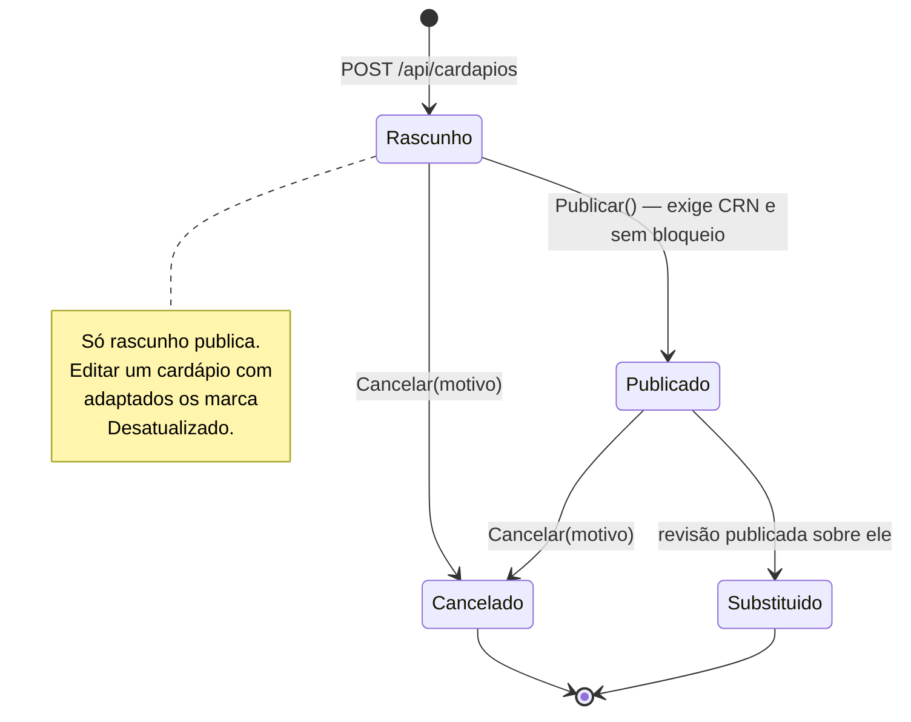

Transições conferidas em `Cardapio.Publicar` e `Cardapio.Cancelar`: só rascunho publica;
`Cancelado` e `Substituido` não cancelam de novo.

### 5.2 Versão adaptada (`StatusAdaptacao`)

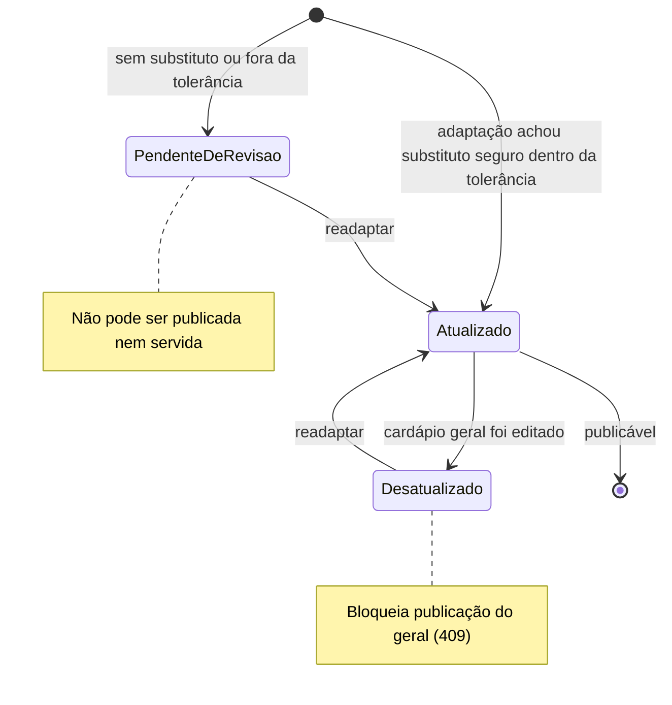

### 5.3 Solicitação (`StatusSolicitacao`)

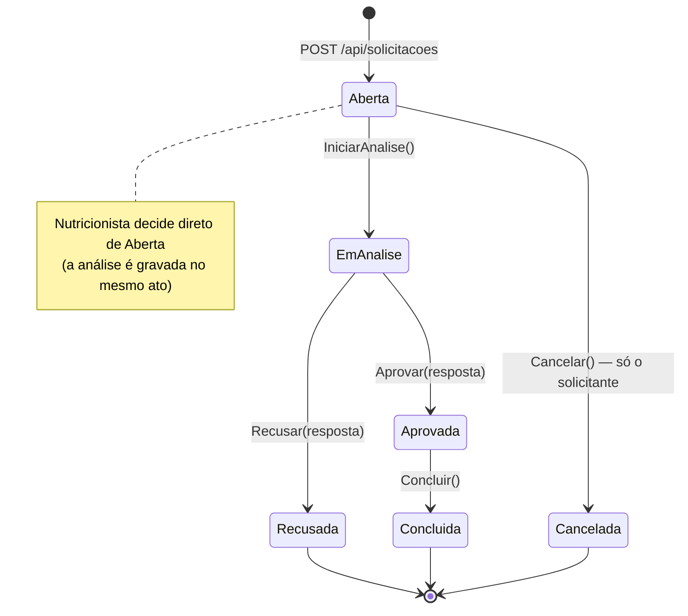

Tabela executável em `Solicitacao.TransicoesPermitidas` (linhas 20–37). Efeito colateral:
aprovar restrição aplica a alteração ao aluno na mesma transação (Spec 017/030).

### 5.4 Ocorrência (`StatusOcorrencia`)

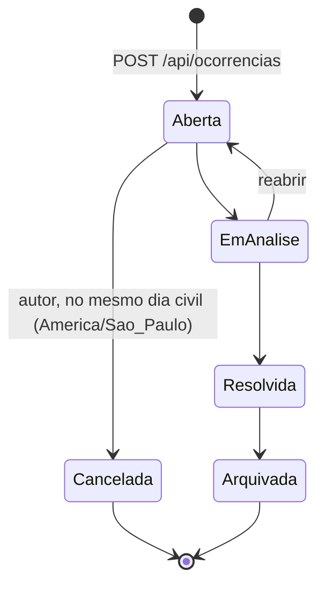

Pares válidos literais em `Ocorrencia.MudarStatus` (linhas 135–138). Mudança de status é
exclusiva do `AdminEscola` da escola; o registro não é apagado — encerrar é `Arquivada`.

### 5.5 Feedback (`StatusFeedback`)

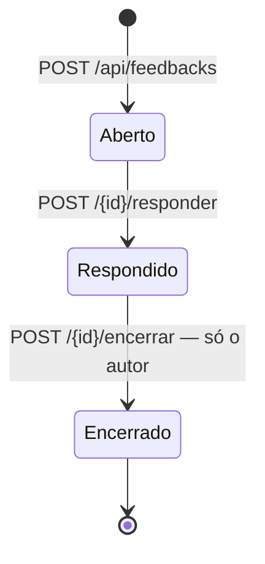

### 5.6 Solicitação de acesso (`StatusSolicitacaoAcesso`)

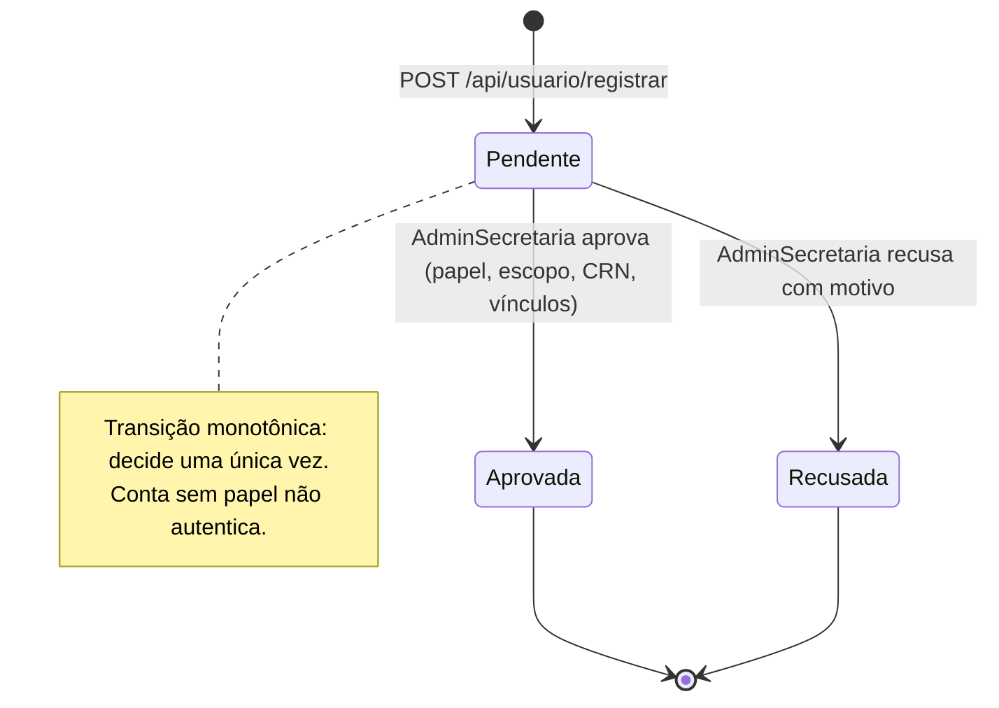

---

## 6. Notas de leitura

1. **Fonte de verdade.** Este arquivo descreve o código; status de spec e pendências vivem em
   `management/roadmap.md` e `management/pending-items.md`. Divergência entre diagrama e
   código deve ser corrigida no diagrama.
2. **O que foi omitido de propósito:** índices secundários, colunas de auditoria
   (`CriadoEmUtc`, `AtualizadoEmUtc`), detalhes de `HistoricoCardapio`/`EventoCardapio` e as
   54 linhas de registro de DI em `Program.cs`.
3. **Cardápio com dias (Spec 037)** não aparece nos diagramas de dados: `DiaDeCardapio` não
   existe no código — `Refeicao` continua presa diretamente ao `Cardapio`. O mesmo vale para
   sugestão por IA (Spec 026). Ver a ressalva de rastreabilidade no `roadmap.md`.
4. **Frontend:** um diagrama de rotas por papel já existe de forma textual em
   `funcionalidades.md` §1–§9; não foi duplicado aqui.
